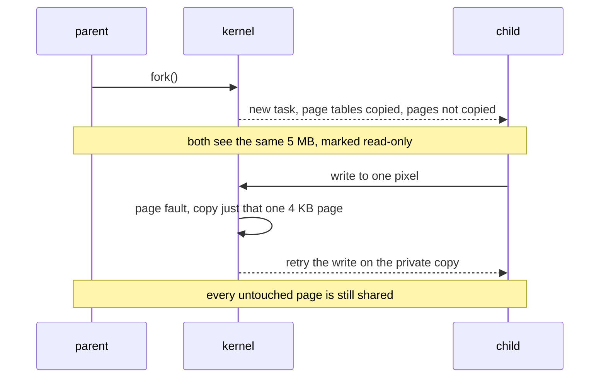
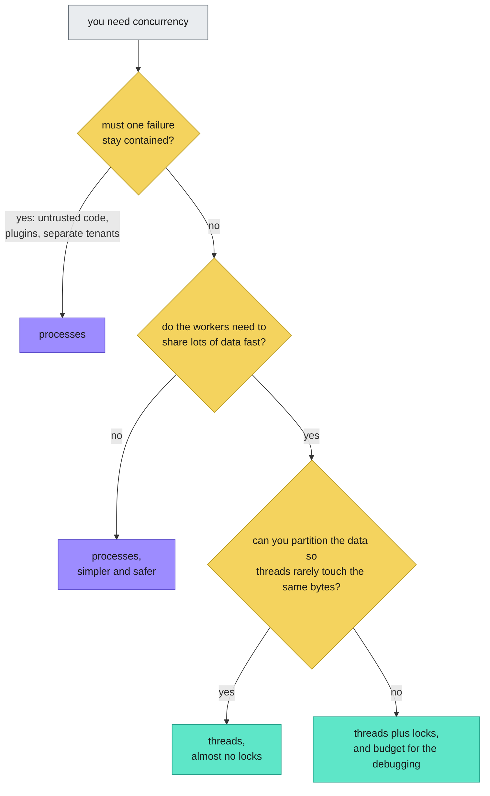

<em>Hello, I'm Maneshwar, and I'm building LiveReview — a blast-radius aware AI code review built for your business-critical systems. [Star us](https://github.com/HexmosTech/LiveReview/) to help devs discover the project, give it a try, and share your feedback to help improve the product.</em>

"What is the difference between a process and a thread?"

You have been asked this. You have probably asked it.

The standard answer goes: a process is heavy, a thread is light, and threads share memory.

That answer is true.

It is also the kind of true that you can recite for ten years without ever understanding what is going on underneath.

So let's skip the textbook and look at both from the seat where the decisions actually get made.

**The kernel's seat.**

## Start with one long bar of RAM

Picture your machine's memory as a single long bar. Say 16 GB.

All of it belongs to the kernel. No program is allowed to touch it directly.

When you launch an app, the kernel creates a **process** to represent it, and carves out a slice of the bar as that process's private memory.

It writes down who owns which slice in a notebook, and it guards those boundaries.


Now watch it with real software.

You open a photo editor. The kernel makes a process for it, and the editor fills its slice with a 5 MB photo.

You also have Spotify open. That is a second process, with a second slice further down the bar.

The editor cannot read Spotify's memory. Spotify cannot read your photo.

If the editor reaches outside its slice, the kernel stops it on the spot.

And if Spotify crashes, your photo does not even flinch.

That wall is the entire reason one program cannot read or corrupt another's data.

### A small confession about the bar

The bar is a *teaching* picture, and it is a little too tidy.

Real kernels do not hand out literal chunks of physical RAM. Every process gets its **own virtual address space**, and the CPU's memory management unit translates those addresses through page tables that the kernel controls.

Two processes can both use "address 0x1000" and land on completely different physical memory.

Touch an address that is not mapped for you, and the hardware raises a fault, and the kernel typically answers with a `SIGSEGV`.

The [kernel's own memory docs](https://www.kernel.org/doc/html/latest/admin-guide/mm/concepts.html) cover the concepts if you want the full tour.

The wall in the picture is a very real wall. It is just made of page tables instead of drywall.

## Now the editor wants to be fast

Brightening a photo one pixel at a time on a single core is slow.

So the editor asks the kernel for help: "give me four threads".

Here is the part that matters.

**The kernel does not hand each thread more RAM.**

It creates four lightweight tasks and points all of them at the *same slice* the process already owns.

Then it schedules those four tasks onto four cores, and they run at the same moment.

Each thread takes a quarter of the photo and brightens its own region, reading and writing the pixels directly where they sit.

Nothing was copied.

When the last thread finishes, the whole image is already brighter.


Now imagine doing the same job with four **processes** instead.

Each one needs its own slice. So the photo gets copied into all four, which is four times the memory.

Then somebody has to collect the four finished pieces and stitch them back together, which means sending data between processes with pipes, sockets or shared memory.

That is the entire pitch for threads in one sentence: **they skip the copy, and they skip the stitching.**

### A fairness note for processes

I have been a bit mean to processes, so let me correct the record.

Modern `fork()` does not actually copy the whole photo up front. On Linux it is [implemented with copy-on-write pages](https://man7.org/linux/man-pages/man2/fork.2.html).



So the child starts almost for free, and only pays for pages it actually changes.

The picture above is the *worst case*, where every process rewrites everything. That is the case that happens when a job really does touch the whole photo.

The real difference is not "copy vs no copy" so much as **"shared by default" vs "private by default".**

And that, as we are about to see, is where all the trouble comes from.

## The kernel's dirty secret: they are the same thing

Here is the sentence that rewired my head.

**To the Linux kernel, a process and a thread are nearly the same object.**

Both are just a *task* that the scheduler puts onto a CPU.

The scheduler does not schedule "processes". It schedules tasks. A four-thread process is four tasks that happen to be friends.

The only real difference is memory:

- make a new task with a **fresh** slice, and you have a process
- make a new task pointed at an **existing** slice, and you have a thread

On Linux that choice is one function: [`clone()`](https://man7.org/linux/man-pages/man2/clone.2.html), and one flag: `CLONE_VM`.


Do not take my word for it. Here is a tiny program that does the same write twice, once from a child process and once from a thread:

```c
int brightness = 0;

void *worker(void *arg) { brightness = 100; return NULL; }

int main(void) {
    pid_t child = fork();
    if (child == 0) { brightness = 100; _exit(0); }   // a process writes
    waitpid(child, NULL, 0);
    printf("after a child PROCESS wrote 100: brightness = %d\n", brightness);

    pthread_t t;
    pthread_create(&t, NULL, worker, NULL);            // a thread writes
    pthread_join(t, NULL);
    printf("after a THREAD wrote 100:        brightness = %d\n", brightness);
}
```

I compiled it and ran it on Ubuntu 24.04:

```plaintext
after a child PROCESS wrote 100: brightness = 0
after a THREAD wrote 100:        brightness = 100
```

Same line of code in both. The process wrote into *its own copy* and the parent never saw it. The thread wrote into *the* copy.

Then I ran the same binary under `strace -f -e trace=clone,clone3` to see what glibc really asked the kernel for (trimmed a little):

```plaintext
clone(child_stack=NULL, flags=CLONE_CHILD_CLEARTID|CLONE_CHILD_SETTID|SIGCHLD)
clone3({flags=CLONE_VM|CLONE_FS|CLONE_FILES|CLONE_SIGHAND|CLONE_THREAD|CLONE_SYSVSEM|CLONE_SETTLS|...})
```

The first line is `fork()`. No `CLONE_VM`.

The second is `pthread_create()`. There it is, `CLONE_VM`, plus friends.

Those friends decide what *else* gets shared:

- `CLONE_FILES`: the open file descriptors
- `CLONE_SIGHAND`: the signal handlers
- `CLONE_THREAD`: the new task joins the same **thread group**, which is why `getpid()` returns the same number for every thread and the kernel hands each one its own thread id instead

(In my run the main thread and the worker both reported the same `pid`, and the worker had its own `tid`. The man page for [`gettid`](https://man7.org/linux/man-pages/man2/gettid.2.html) covers the details.)

And what is private to each thread? Its own **stack**, its own **registers**, and its own thread-local storage. Everything else, the heap and the globals and the open files, is shared.

A fun side effect of all this: containers are the same trick. [Namespaces](https://man7.org/linux/man-pages/man7/namespaces.7.html) are created with `CLONE_NEW*` flags on the same `clone()` call. Linux has one very flexible "make a task" function, and the whole zoo of processes, threads and containers is just different flag combinations.

## Danger one: two threads, one pixel

Now for the bill.

The kernel let all four threads into the same memory. That is the whole point. It is also the whole problem.

If two threads write the same pixel at the same time, you get a **race condition**.

Here is how it goes wrong. Both threads add 10 to a pixel that holds 50:


Both read 50. Both compute 60. Both write 60.

You expected 70. You got 60.

There is no crash. There is no error. One brighten operation simply evaporated.

I wanted a real number instead of a hand-wavy one, so I ran four threads, each bumping one shared counter a million times:

```c
for (int i = 0; i < 1000000; i++) {
    unsafe++;                      // shared, no protection
    pthread_mutex_lock(&lock);
    safe++;                        // shared, behind a mutex
    pthread_mutex_unlock(&lock);
}
```

```plaintext
expected: 4000000
no lock:  3966879
mutex:    4000000
```

Over thirty thousand increments went missing, and the program exited happily. A second run lost a different amount.

That is what makes races miserable. They are not wrong in a consistent way. They are wrong in a *different* way every time, which is a spectacular property for a bug to have when you are trying to reproduce it.


The textbook fix is a **lock**. Only one thread at a time may touch the contended spot, and the rest wait their turn.

That works. It also costs you, because threads that wait are threads that are not working.

The better fix is to need no lock at all.

Look again at the photo example. Each thread was given its *own quarter*. Nobody writes anyone else's pixels, so nobody has to wait for anybody.


The best concurrency code is the kind where the threads rarely touch the same data. Partition first, lock only the seams.

## Danger two: shared memory means shared fate

The second bill is nastier because it is not subtle.

All four threads live in one address space. So when one of them does something the kernel considers fatal, the kernel has no way of killing "just that thread".

A segmentation fault on any thread, and the default action for that signal is to [terminate the whole process](https://man7.org/linux/man-pages/man7/signal.7.html).

I did not want to just claim that, so I tried it. One thread ticks along. Another sleeps half a second, then writes through a null pointer:

```plaintext
steady thread: tick 1
steady thread: tick 2
steady thread: tick 3
Segmentation fault (core dumped)       # exit code 139
```

The steady thread had two more ticks to go. It never got them.


Three perfectly healthy threads, executed for the crime of sharing an address space with a guilty one.

The same logic applies to quieter failures. A buffer overflow in one thread can scribble over memory that another thread is using, and the crash shows up somewhere completely unrelated, an hour later.

Meanwhile Spotify, a separate process, is still playing. That wall from the first picture just paid for itself.

## So which one do I pick?

You can see this trade-off baked into real software.

[Chrome gives each site its own process](https://www.chromium.org/developers/design-documents/multi-process-architecture/), so one rogue tab cannot take the browser down with it. Isolation is worth the memory.

[PostgreSQL uses a process per connection](https://www.postgresql.org/docs/current/connect-estab.html), so a crashing backend does not take the whole database with it. Isolation is worth the memory there too.

On the other side, anything that crunches one big shared dataset on many cores, like our photo brightener, wants threads, because copying and stitching would eat the speedup.

(And if you are in Python, the [GIL](https://docs.python.org/3/glossary.html#term-global-interpreter-lock) means threads will not run your Python bytecode in parallel in the standard build, which is why so many people reach for processes there. That is a language story, not a kernel one.)

Here is the decision as a flowchart:



## The 30 second interview answer

If somebody asks you the question tomorrow, here is the whole thing:

1. The kernel gives every **process** its own private memory, and the wall between processes is why one app cannot corrupt another.
2. A **thread** is a task the kernel points at memory that already exists, so threads share one address space and nothing gets copied.
3. On Linux both are made by `clone()`. The difference is basically one flag, `CLONE_VM`.
4. Sharing is the speed, and it is also the two dangers: **races** when threads touch the same data, and **shared fate** when one thread crashes.

"Threads are lightweight" was never wrong.

It just left out what you are paying with.

---

<em>
Your team's attention is limited, and the deluge of AI-generated code is making it harder to keep production secure and reliable without slowing you down.

I'm building <strong>LiveReview</strong>, a blast-radius aware AI code review built for your business-critical systems.

Instead of presenting every diff with equal emphasis, <strong>LiveReview scores each change by blast radius — how far its impact reaches through your call graph — so you can focus attention where it actually matters.</strong>

Spend code review effort where business risk is highest — not spread evenly across every diff.

⭐ Star it on GitHub:



<b>Click below to try LiveReview with your codebase:</b>

</em>

<a href="https://hexmos.com/livereview"></a>
