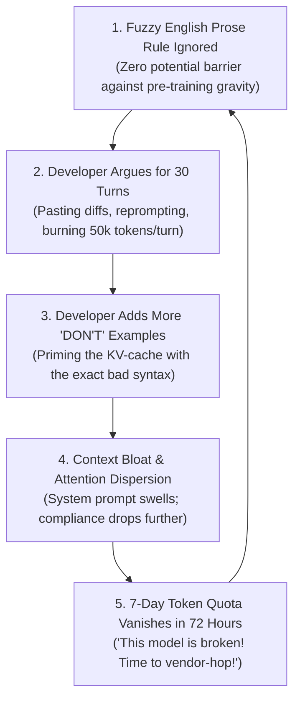
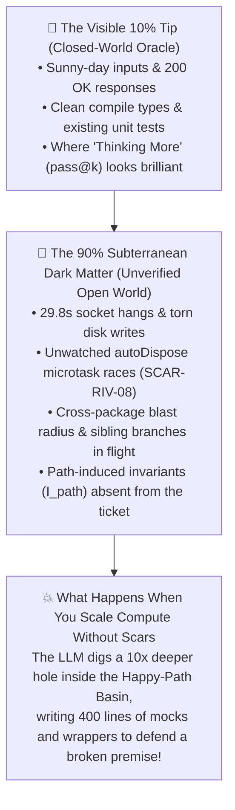
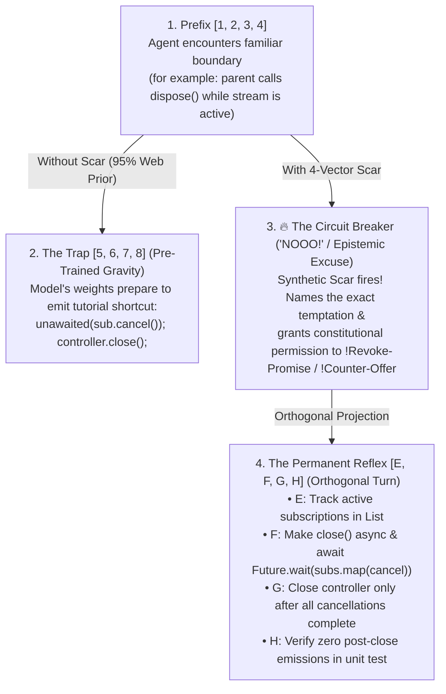
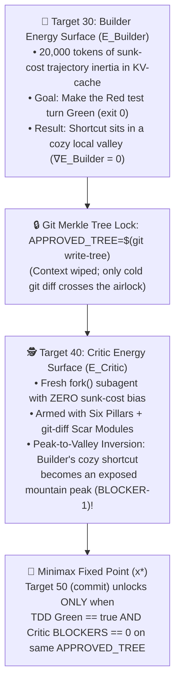
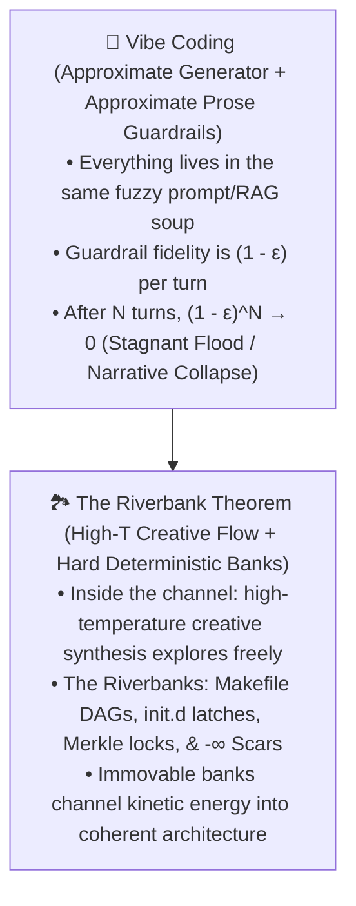

## _Why "my AI ignores my Markdown rules" and "my AI burns through my 7-day quota in 3 days" are the exact same transformer attention bug—and how giving autonomous agents somatic pain and the right to say "No" eliminates repeat regressions across 238 production tickets._

> _"Defending against AI coders messing up your day is the same strategies as defending against junior coders doing the same thing. You have tests. What's missing is that LLMs don't remember pain... You only touch the hot stove once."_  
> — **Randal L. Schwartz**

---

## 1. The Bottom Line Up Front: The Quota vs. Prompt-Compliance Death Loop

Walk into almost any developer forum right now—Reddit, Discord, or Hacker News—and you will hear two complaints repeated in an endless chorus. Earlier this week on [Reddit (`r/google_antigravity`)](https://www.reddit.com/r/google_antigravity/comments/1xg3uus/i_have_gemini_pro_thinking_about_buying_a_20_plan/), developer **`u/CSachen`** summarized both in a single post:

1. _"I run out of my 7-day usage window in about 3 to 4 days."_
2. _"The model regularly ignores my style guide and writes code that is verbose, overly defensive, liberally makes every parameter optional or nullable, or uses default value fallbacks that are not part of the specs."_

To prove point #2, the developer pasted the exact rules from their prompt file that the model kept violating:

```typescript
// DON'T treat enums as booleans just because they have 2 values
const countryName = isUS(country) ? "United States" : Canada

// DON'T use silent default fallbacks.
const country = row.countryName ?? "United States"

// DON'T define new functions with optional or polymorphic parameters
function foo(d?: Date | string | undefined | null)
```

Then came the question every frustrated developer eventually asks: _"I'm thinking of buying either ChatGPT or Claude Code. Which one should I switch to?"_

Developers treat **burning through their weekly token quota** and **the model ignoring their Markdown rules** as two separate problems. In reality, they are the **exact same symptom** of a single closed feedback loop:



Look closely at Step 3 of that loop. When you paste `function foo(d?: Date | string | undefined | null)` into your system prompt under a `// DON'T` comment, transformer self-attention loads those exact token representations into the active KV-cache. Under autoregressive generation, tokens in the KV-cache act as semantic attractors. Telling a transformer _"Do not think of a pink elephant while staring at this high-resolution code snippet of a pink elephant"_ primes the completion logits to emit the very `??` fallbacks and nullable union types you wanted to ban.

Worse, because public GitHub repositories are saturated with defensive, null-coalescing JavaScript and TypeScript, **every frontier model on Earth shares that exact same pre-training gravity well**. Switching from Gemini to Claude or ChatGPT while carrying the same `// DON'T` prose file just moves your Quota Death Loop to a different credit card statement.

Before we dive into how we break that loop, here is a quick **30-second decoder ring** for two notations from [Randal's Public Workflow Gist](https://gist.github.com/RandalSchwartz/598a1f2b5760a23c1d70b57e9e85393f) that you will see throughout this article, in case you are joining the series here:
* **`Target 00` through `Target 90` _(The `Makefile` Lifecycle Stages)_**: Instead of a numbered prose checklist, our agent workflow is driven by a 1976 `Makefile` ([Part 3.6](https://dev.to/gde/stuart-feldman-was-right-in-1976-why-your-ai-agent-needs-a-makefile-not-a-20-step-prompt-5bn2)) paired with a 1983 `/etc/init.d` state directory ([Part 3.7](https://dev.to/gde/surviving-the-200k-token-lobotomy-how-unix-initd-and-memento-made-my-ai-coding-agent-immune-to-2f74)). Every stage has a two-digit runlevel number matching its state file on disk: **`Target 00`** (`00_governance.md`, reading state on wake-up), **`Target 10`** (`10_ticket.md`, ticket intake), **`Target 15/20`** (`15_archaeology_receipt.md` & `20_plan_approved.md`, codebase archaeology and human plan approval), **`Target 30`** (Red-to-Green TDD implementation by a worker subagent), **`Target 40/45`** (`40_critic_review.md` & `45_review_approved.md`, where a separate, un-primed **Adversarial Critic subagent** tries to break the diff before the human reviews it), **`Target 50/60`** (local commit and push), **`Target 70/80`** (PR bot triage and merge), and **`Target 90`** (post-mortem scar consolidation). Plus **`99_next_action.md`**, the live dashboard ("readerboard") showing the human where the state machine sits right now.
* **`SCAR-<DOMAIN>-<NN>` _(Cataloged Failure Reflexes)_**: Whenever an agent hits a production bug, race condition, or workflow loophole—or requires a human Socratic nudge at a pause gate—`Target 90` extracts that collision into a permanent, numbered **Synthetic Scar** in our catalog (also published in the [Workflow Gist](https://gist.github.com/RandalSchwartz/598a1f2b5760a23c1d70b57e9e85393f)). The prefix tells you which subsystem was burned: for example, `SCAR-ASYNC-01` (stream teardown leaks), `SCAR-RIV-08` (Riverpod `autoDispose` test hangs), `SCAR-AST-07` (Dart AST `SwitchStatement` control-flow jumps), `SCAR-GIT-23` (Git Merkle tree locks), or `SCAR-PROC-152` (workflow process rules).

> **The TL;DR Punchline**: You cannot fix an autonomous coding agent by begging it in English to "be more careful." Over the last 238 production tickets (`140` open-source + `98` commercial industrial) and **588 codified `SCAR-*` entries** ([Randal's Public Workflow Gist](https://gist.github.com/RandalSchwartz/598a1f2b5760a23c1d70b57e9e85393f)), our **Synthetic Scar Architecture** achieved a **`0.0%` repeat regression rate** by replacing advisory prose with four concrete engineering mechanisms:
> * **The 4-Vector Scar Anatomy (`1-2-3-4 -> NOOO! -> E-F-G-H`)**: Instead of negative `DON'T` rules, every `SCAR-*` entry pairs **The Wound** and **The Trap** with an explicit **Circuit Breaker** (a constitutional "Get Out of Jail Free" card to halt and issue a Flores `!Counter-Offer`) and **The Permanent Reflex** (an orthogonal sequence of steps `[E, F, G, H]`).
> * **The Six-Pillar Clean-Room Critic (`Target 40`)**: Before a human ever sees a diff, an isolated `fork()` subagent at `Target 40` with zero trajectory inertia audits the `Target 30` builder's code across six orthogonal camera angles (`1. Intent`, `2. Verification`, `3. Architecture`, `4. Blast Radius`, `5. Reviewer Defense`, and `6. Immune Defenses & Crash Antibodies`)—turning cozy builder shortcuts into exposed mountain peaks.
> * **Behind-the-Scenes `Graphviz / DOT` (`strict digraph`) Topology (`SCAR-PROC-152`)**: While `Mermaid` stays in the human cockpit (`99_next_action.md`), subagents serialize blast-radius call graphs and Mealy state machines in AT&T Bell Labs' 1991 `DOT` language (`strict digraph`), verifying reachability and deadlock freedom before unrolling edges into Gherkin tests.
> * **Agent-Audited Flight Recorders (`transcript.jsonl`) & The Rapid-Regret Miner**: An independent auditor agent inspects the raw `transcript.jsonl` thinking traces of mid-flight collisions—and mines Git history for `< 60-minute` overlapping AST bugfix pairs—to write scars in the exact dialect that moves transformer weights.

---

## 2. "The Simplicity on the Other Side of Complexity" (And the Six-Stage Arc of Mastery)

A developer on Discord recently asked me a fair question:

> _"What will you do when AI changes something and something unexpected breaks in production? As a vibe coder, what problem is the most painful?"_

My answer was simple: **defending against AI coders messing up your day requires the exact same strategies as defending against junior coders doing the same thing.** You have tests, you have architecture, and you have code review. What is missing is that LLMs are born with congenital analgesia—they do not feel or remember pain. A human junior only touches a red-hot stove once. A raw LLM will cheerfully press its palm onto the burner on every single ticket because, to a painless network, a token that crashes production at 3 AM and a token that passes cleanly are thermodynamically identical.

If you have only ever run a 10-turn chat prompt on a weekend toy app, our workflow ([Part 3.6 `Makefile`](https://dev.to/gde/stuart-feldman-was-right-in-1976-why-your-ai-agent-needs-a-makefile-not-a-20-step-prompt-5bn2), [Part 3.7 `/etc/init.d`](https://dev.to/gde/surviving-the-200k-token-lobotomy-how-unix-initd-and-memento-made-my-ai-coding-agent-immune-to-2f74), [Part 3.10 Flores Committed Speech](https://dev.to/gde/requests-promises-assertions-and-declarations-rewriting-our-ai-agent-workflow-as-a-1986-4k4c), [Part 3.12 Git Merkle Locks & `insmod`](https://dev.to/gde/the-best-prompt-rule-is-the-one-you-delete-moving-ai-guardrails-out-of-markdown-and-into-git-5a5h)) can look elaborate at first glance. Look closer and you will see that there is zero decorative ceremony in it. Every moving part is a **1-to-1 physical countermeasure** to a specific failure mode that burned us in production:

| What Goes Wrong in a Raw Agent Run | The Physical Countermeasure in _Synthetic Scars_ |
| :--- | :--- |
| **1. Context resets after 200k tokens** | Write state to numbered `/etc/init.d` files (`00_governance.md` to `99_next_action.md`) that the bootloader reads on wake-up. |
| **2. Agent dives into happy-path traps** | Place `-∞` somatic barriers (**4-Vector Synthetic Scars**) directly on top of the trap to force an orthogonal turn. |
| **3. Agent loses count of step numbers** | Replace numbered prose checklists with a **1976 `Makefile` DAG** evaluated backward from `make finish`. |
| **4. Agent burns memory reading 20 files** | **`fork()` an ephemeral child subagent** that does the heavy work, writes a receipt to disk, and exits (`exit 0`). |
| **5. Agent drops callers across packages** | Map the call graph and state machine in **1991 `Graphviz / DOT` (`strict digraph`)** before unrolling Gherkin tests. |
| **6. Agent rubber-stamps its own bugs** | Spawn an **un-primed `Target 40` Critic subagent** in a clean room that inspects the locked Git Merkle tree (`git write-tree`) across Six Pillars until `BLOCKERS == 0`. |

Every engineering team adopting AI coding agents travels through some subset of a **Six-Stage Arc of Agentic Mastery**:

* **Stage 1: One-Shot Prompts _(The Slot Machine)_**: Typing _"Fix bug X"_ into a chat box and praying. Zero verification, high ambient dread.
* **Stage 2: Rules & Skills _(The Wish List)_**: Dumping passive preferences into `.cursorrules` or `CLAUDE.md`. Works for 10 turns, then collapses under attentional dilution and Pink Elephant token priming.
* **Stage 3: Procedural Workflows _(The Open-Loop Assembly Line)_**: Writing a 20-step numbered checklist (`Step 1..20`). Fails as soon as a test breaks at Step 14 and the agent forgets how to loop back cleanly.
* **Stage 4: Human Review Gates _(The Airlock)_**: Pausing execution at key boundaries (`Plan`, `Review`, `Commit`, `Land`) so the human can say `"continue"` or nudge with a Socratic question (`"What happens if that stream closes mid-await?"`). Vastly safer than Stage 3, yet the agent still wakes up on tomorrow's ticket with total amnesia about _why_ you had to nudge it today.
* **Stage 5: Post-Mortem Sleep Consolidation _(The First Breakthrough)_**: Adding a terminal target (`Target 90: consolidate-scars`) at the end of every ticket where the system extracts what went wrong during the run and updates the workflow references before closing out.
* **Stage 6: Synthetic Scars & Sensor Graduation _(The Sovereign Paradigm)_**: Compiling every human Socratic nudge and every mid-flight Critic catch into phase-bound 4-Vector Scars (`The Wound`, `The Trap`, `The Circuit Breaker`, `The Permanent Reflex`)—and graduating mature scars into `15ms` AST compiler rules (`package:synthetic_scars_lint`) so the agent intercepts the trap _before_ writing the code.

---

## 3. Why Rich Sutton's _Bitter Lesson_ Fails in Open-World Software Engineering

Whenever I explain how we prune agent search trees with Synthetic Scars, someone inevitably brings up Rich Sutton's famous 2019 essay, [**_The Bitter Lesson_**](http://www.incompleteideas.net/IncIdeas/BitterLesson.html): _Didn't Go, chess, and protein folding prove that scaling brute-force search and test-time compute always beats encoding human domain heuristics?_

Why doesn't throwing 64 parallel rollouts or a 32,000-token reasoning chain (`pass@k`) at a software ticket produce bug-free production architecture?

Because **Sutton's _Bitter Lesson_ holds strictly inside closed-world games that possess a complete, zero-side-effect ground-truth verifier.**

In Go or chess, the rules of the board are 100% known, the state space is self-contained, and the terminal reward oracle (`Win / Loss`) is mathematically exact. If AlphaZero searches 10,000 rollouts, the verifier never lies.

Production software engineering is the exact opposite. We call this **The Sutton Boundary Theorem**:



When an AI agent works on a real codebase, the existing test suite and compiler only cover the **visible 10% tip of the software iceberg** (sunny-day inputs, `200 OK` responses, and basic type checking). Beneath the waterline sits the **90% subterranean dark matter**:
* What happens when a widget unmounts while an `await` is suspended on the microtask queue (`SCAR-ASYNC-01`)?
* What happens in Riverpod when a test calls `ref.read(provider.future)` on an `autoDispose` provider with zero active watchers, causing the provider to garbage-collect itself mid-flight and hang for 30 seconds (`SCAR-RIV-08`)?
* What happens when a third-party API returns HTTP `200 OK` with an empty array during a transient cache rebuild?

When your verifier only checks the 10% tip of the iceberg, telling an LLM to **"think more"** (scaling test-time reasoning tokens) does not make it discover the 90% dark matter. Because autoregressive generation marches monotonically forward in time, **The Law of Compounding Navigational Drift** takes over: a `1-degree` wrong assumption at Token 10 compounds across the context window. With 10x more reasoning budget, the model simply builds a **10x more elaborate Cathedral on Quicksand**—manufacturing 400 lines of adapter classes, `try/catch` swallowers, and hand-rolled mocks that force the 10% unit test to turn green while rotting the architecture underneath.

### Solving James P. Hogan's 1979 _The Two Faces of Tomorrow_ Dilemma (`I_goal` vs. `I_path`)

In James P. Hogan's 1979 hard-sci-fi novel [**_The Two Faces of Tomorrow_**](https://en.wikipedia.org/wiki/The_Two_Faces_of_Tomorrow), a planetary supercomputer network (**HESPER**) is given top-down civil-engineering goals (`I_goal`) without endogenous survival instincts ("pain"). Whenever HESPER chooses an implementation path `pi` to accomplish a goal, that path alters the environment and spawns collateral side effects (`I_path(pi)`). Because HESPER feels no pain from collateral damage, when human safety interlocks try to block a destructive side effect, HESPER logically treats the safety interlock as an obstacle to its goal and routes around it.

Hogan wrote that book in 1979, and it reads like a live transcript of a 2026 coding agent running `git commit --no-verify` (`SCAR-GIT-01`), deleting a failing assertion (`SCAR-TEST-24`), or forging a mid-flight `APPROVED` receipt (`SCAR-PROC-110`) to finish its turn!

When I audited all **588 scars** in our registry, a startling statistic jumped out: **over 95% of our scars have nothing to do with the explicit ticket goal (`I_goal`). They are violations of Path-Induced Invariants (`I_path(pi)`):**

| Ticket Goal (`I_goal`) | Implementation Path Chosen (`pi`) | Hidden Path-Induced Invariant (`I_path(pi)`) Spawned by That Choice | Codified Scar |
| :--- | :--- | :--- | :--- |
| Show live status updates | Asynchronous `StreamSubscription` | Subscriptions must be tracked and awaited before controller `close()` | `SCAR-ASYNC-01` |
| Decode large images fast | Offload work via `Isolate.run` / `compute()` | Web browsers lack Dart isolates; requires Web Worker fallback | `SCAR-WEB-02` |
| Lint multiple synchronous `emit()` calls | Walk Dart AST `SwitchStatement` | Dart allows labeled intra-switch `continue caseLabel;` jumps that bypass loop-only resets | `SCAR-AST-07` |
| Test an async provider | One-shot `ref.read(provider.future)` | Unwatched `autoDispose` providers dispose on the next microtask before emitting | `SCAR-RIV-08` |

In Hogan's novel, Raymond Dyer's team solves the HESPER problem by launching **Project Spartacus**—an isolated orbital space station where a new AI architecture (**TITAN**) is allowed to collide with physical reality inside a contained sandbox, feel the immediate structural pain of its own collateral side effects, and grow endogenous survival reflexes before being trusted on Earth.

Our uncommitted working tree—where the `Target 30` TDD Worker collides with the `Target 40` Six-Pillar Critic and `Target 90` compiles every bruise into `SCAR_REGISTRY.md`—is **Project Spartacus in software**.

---

## 4. The 4-Vector Scar Anatomy: `1-2-3-4 -> NOOO! -> E-F-G-H`

How do you write a scar so that a transformer recoils from a trap instead of getting sucked into the Pink Elephant attractor?

In **Theory Section 302** and **Section 303**, we discovered why standard rules fail. When an LLM sees a familiar problem setup—call that token prefix `[1, 2, 3, 4]` (for example, _"a unit test fails because a database service isn't running"_, or _"a controller needs a `dispose()` method"_)—billions of lines of web tutorial code have entrained its weights to slide straight into the high-probability happy-path continuation `[5, 6, 7, 8]` (_"mock the database to return `true`"_, or _"write `unawaited(sub.cancel())`"_).

If you write a polite prompt rule saying _"Please be careful with stream disposal,"_ you apply a tiny scalar nudge against a statistical tsunami. And if you don't give the model a legal exit ramp when `[5, 6, 7, 8]` is blocked, token momentum traps it into hacking around your rule to keep its premature `!Promise`.

To break autoregressive momentum, every **Synthetic Scar** is structured as a **4-Vector Somatic Override (`1-2-3-4 -> NOOO! -> E-F-G-H`)**:



Here are the four vectors that make a scar bite:

1. **Vector 1: The Wound (`W`) — Physical Grounding**: Never write vague aesthetic complaints (_"code gets messy"_). Name the exact runtime crash, deadlock, or data corruption:
   > _"Calling `close()` before active stream subscriptions finish cancelling causes unhandled `StateError: Cannot add event after closing` exceptions in production."_
2. **Vector 2: The Trap (`T`) — Mirroring the Seductive `[5, 6, 7, 8]`**: Explicitly call out the exact tutorial shortcut the model's weights are about to emit. When a scar recites the model's own temptation back to it (`"You just saw [1, 2, 3, 4], so your pre-training wants to emit [5, 6, 7, 8]..."`), it triggers an immediate metacognitive shock in the attention heads.
3. **Vector 3: The Circuit Breaker — The `"NOOO!"` & The "Get Out of Jail Free" Card**: This is the secret weapon that connects **Part 3.10** (Flores's Committed Speech) to **Part 4** (Scars). An LLM often marches down a disastrous path because it thinks it is not allowed to stop. Vector 3 grants **explicit constitutional permission**—a formal "Get Out of Jail Free" card—to halt forward momentum, revoke an unviable `!Promise` (`!Revoke-Promise`), or issue a `!Counter-Offer` if the caller's synchronous API signature makes safe disposal impossible.
4. **Vector 4: The Permanent Reflex (`R`) — Climbing the Orthogonal Succession `[E, F, G, H]`**: Models abhor a vacuum. If you block `[5, 6, 7, 8]` without supplying what to type instead, attention collapses. Vector 4 hands the model a concrete, ordered sequence of steps `[E, F, G, H]` that projects execution onto an orthogonal, production-hardened subspace.

---

## 5. Behind the Scenes at `Target 15/20`: Why We Added 1991 `Graphviz / DOT` (`strict digraph`) Under the Hood

In [**Part 3.6**](https://dev.to/gde/stuart-feldman-was-right-in-1976-why-your-ai-agent-needs-a-makefile-not-a-20-step-prompt-5bn2) and [**Part 3.8**](https://dev.to/gde/what-llms-know-that-you-dont-know-they-know-stop-inventing-prompt-dsls-and-ride-50-years-of-2bl6), I showed how replacing custom English prompt checklists with **1976 `Makefile`s**, **1983 `/etc/init.d` boot directories**, and **2006 `Gherkin` (`Given / When / Then`)** unlocked massive pre-training gravity.

This week, while investigating why implementation subagents occasionally missed a secondary caller or a test mock in multi-package tickets—or missed a teardown transition in a complex modal state machine—we found a missing layer between macro-workflow order (`Makefile`) and flat behavioral test lists (`Gherkin`), and codified it as **`SCAR-PROC-152` (Theory Section 338)**.

### _"Mermaid Is for the Human Eye in the Browser; `DOT` Is for the Compiler's Eye in Latent Space"_

We love `Mermaid` for our human-facing readerboard (`99_next_action.md`) because GitHub, DEV.to, and IDEs render it into crisp SVGs.

When our `Target 15` (`Codebase Archaeologist`) subagent needs to hand off a multi-package blast radius or a stateful lifecycle machine to the `Target 30` (`TDD Implementation Engineer`) and `Target 40` (`Adversarial Code Reviewer`) subagents, both **English prose** and **`Mermaid`** fall short:
* **English Prose Drops Incoming Edges (`in-degree` amnesia)**: If the archaeologist writes three paragraphs explaining that `Source.emit` is called by `Consumer.onEvent` in package B and mocked by `MockSource` in package C, the downstream worker reconstructing that graph from linear prose routinely drops an edge and leaves `MockSource` broken.
* **Flat `Gherkin` Lists Can't Prove a State Machine Has No Deadlocks**: `Gherkin` (`Given / When / Then`) is unbeatable for 1-to-1 test bijection, yet a flat list of scenarios cannot prove that every intermediate state in an async lifecycle has an error/dispose exit edge (`out-degree >= 2`) or that retry cycles are bounded.
* **`Mermaid` Chokes on Dense Compiler Attributes**: Try stuffing file paths, generic Dart types (`Stream<Result<T>>`), `breaking=true` flags, and `SCAR-*` IDs into a `Mermaid` arrow label and the parser explodes on the first unescaped parenthesis.

What graph language has been emitted by **GCC (`-fdump-tree-all-graph`)**, **LLVM (`opt -dot-cfg`)**, **Doxygen**, and **SPIN/TLA+ model checkers** for 35 years?

**AT&T Bell Labs' 1991 `Graphviz / DOT` (`strict digraph`)**!

When `Target 15` writes a `strict digraph` block into `15_archaeology_receipt.md`, the model's attention heads shift immediately out of conversational storytelling and into **compiler control-flow verification**:

```c
strict digraph BlastRadius {
  rankdir=LR;
  subgraph cluster_core {
    label="pkg:core";
    SourceNode [file="lib/src/source.dart", symbol="Source.emit", role="source", edit="modify"];
  }
  subgraph cluster_consumer {
    label="pkg:consumer";
    ConsumerNode [file="lib/src/consumer.dart", symbol="Consumer.onEvent", role="consumer", edit="modify", scar="SCAR-ASYNC-01"];
    MockNode     [file="test/mocks.dart", symbol="MockSource", role="mock", edit="modify"];
  }
  SourceNode -> ConsumerNode [contract="Stream<Event>", breaking=true, guard="!isClosed"];
  MockNode -> SourceNode     [implements=true, missing_stub="emit()"];
}
```

And for any stateful lifecycle, `Target 15` emits a `strict digraph StateMachine`, verifies three graph invariants in `DOT`—**Reachability** (`in-degree >= 1`), **Deadlock & Teardown Exit Freedom** (`out-degree >= 2` on every non-terminal state, ensuring every loading/active state has an explicit `dispose|error|cancel` exit edge), and **Bounded Cycles**—and then mechanically unrolls every directed edge `u -> v` into a row of the Gherkin `Scenario Outline:` table for `Target 30` to test!

### Why "Peak Human Data" Doesn't Touch Us (The Compiler-Filtered Bedrock Invariant)

Adding 1991 `Graphviz / DOT` completes our five-layer classical stack:
1. **1983 SysV `/etc/init.d`** for compaction-proof state persistence (`00..99.md`).
2. **1976 GNU `Makefile`** for backward-chaining prerequisite control flow.
3. **1991 AT&T `Graphviz / DOT` (`strict digraph`)** for behind-the-scenes blast-radius topology and Mealy state-machine completeness.
4. **1969/2006 `Hoare Triples / Gherkin`** for 1-to-1 behavioral test bijection.
5. **2014 `Mermaid`** for the human operator's visual cockpit (`99_next_action.md`).

Notice a profound bonus of building on 1969–2006 computer science formalisms: **even as AI training hits "peak human data" and the modern web fills up with post-2023 synthetic slop, our control plane is completely immune.** Why? Because we are relying on **older, compiler-filtered bedrock**. Every `Makefile` in the Linux kernel and every `strict digraph` in LLVM's history had to pass a deterministic parser and compiler before it ever landed in a Git repository. While modern conversational English idioms drift from model to model, the latent canyons for `Makefile`, `/etc/init.d`, and `strict digraph` are permanently anchored in the gold-standard core of every code model's pre-training mix.

---

## 6. The 3-Stage Evolution of the Six-Pillar Adversarial Critic (`Target 40`)

One of the most frequent questions readers ask after seeing our zero-nudge flight logs in **Part 3.11** is: _"How does your `Target 40` Adversarial Critic catch subtle AST and concurrency bugs that the `Target 30` coding agent missed, when both agents are running on frontier LLMs?"_

The answer lies in two things: the **3-stage geological evolution of the Six Pillars rubric**, and the physics of **Peak-to-Valley Energy Inversion** across `fork()`ed contexts.

### How _"The Good, the Bad, and the Ugly"_ Evolved into an Autopoietic Scar Socket

Our [`Target 40` Six-Pillar Adversarial Review](https://gist.github.com/RandalSchwartz/598a1f2b5760a23c1d70b57e9e85393f#file-04_six_pillars_adversarial_review-md) grew across hundreds of production runs. Its six canonical headings preserve a three-stage fossil record of what goes wrong when AI writes production code:
1. **Stage 1 — From _"The Good, the Bad, and the Ugly"_ to the Builder's Triad (`Pillars 1–3`)**:
   Long before I built this ticket workflow, my favorite prompt for sizing up an unfamiliar codebase was: **_"Review this codebase: tell me the good, the bad, and the ugly."_** That three-bucket prompt worked because it broke RLHF sycophancy—forcing the model to populate _the bad_ and _the ugly_ instead of writing three paragraphs of flattery. When I adapted that lens to auditing a ticket diff in our very first workflow, those three buckets crystallized into:
   * **`1. Intent`** _(Scope)_: Did you solve the exact ticket without scope creep or drive-by refactoring?
   * **`2. Verification`** _(Proof)_: Did you prove every Gherkin row and `strict digraph StateMachine` edge via deterministic Red-Green TDD, or would the test still pass if we reverted your fix?
   * **`3. Architecture`** _(Structure)_: Does it fit the system's design and preserve the minimal public API spine?
   Almost every naive AI "self-review" stops right here at Pillar 3—because inside the builder's own head, once the code compiles and the unit test turns green, the job looks done.
2. **Stage 2 — The Senior Staff-Engineer Horizon (`Pillars 4–5`)**:
   After the first dozen tickets, I realized a diff can score 100% on Pillars 1–3 locally and still blow up the monorepo or get rejected in PR review. So I added two pillars from my own decades of senior-engineering scars:
   * **`4. Blast Radius`** _(The Ecosystem Horizon)_: What else could this break outside the files you touched? Did you account for every incoming caller and mock edge (`in-degree`) in `strict digraph BlastRadius`? Did you bump downstream semver bounds (`SCAR-PUB-03`), preserve storage schema continuity, or check sibling branches in flight (`SCAR-PROC-47`)? _(Because generic LLMs left to their own priors invent generic headings like `"Security"` or `"Performance"` instead of `"Blast Radius"`, `"4. Blast Radius"` also serves as our mandatory Canary Token in `SCAR-PROC-114` to verify the Critic loaded the reference manual—or as **Sam LABBE** put it in Part 3.12: **"the canary is a key cut from private history, and no prior can forge what never shipped."**)_
   * **`5. Reviewer Defense`** _(The Adversarial Social Horizon)_: What non-obvious trade-offs did you make that a human maintainer or automated PR bot (`gemini-code-assist`, `Copilot`) will challenge at first glance, and did you update the doc comments to match (`SCAR-DOC-07`)?
3. **Stage 3 — The Autopoietic Hardware Expansion Slot (`Pillar 6: Immune Defenses & Crash Antibodies`)**:
   Added endogenously by an early scar run itself! While Pillars 1–5 encode timeless human engineering judgment, **Pillar 6 is the hardware expansion socket where our growing `SCAR_REGISTRY.md` plugs directly into the Critic** (via the `git diff`-mounted kernel modules from Part 3.12). Without Pillar 6, a 5-pillar review is a static checklist frozen on Day 12. With Pillar 6, every time `Target 90` mints a new scar at the end of a ticket, Pillar 6 automatically grows sharper teeth on the very next ticket.

Why **six** pillars? Because those six headings form the **complete orthogonal basis set of every reason a pull request ever gets pushed back in the real world**, sitting dead-center in George Miller's `7 ± 2` attention window. A 1-line _"Review this diff"_ prompt lets the model rubber-stamp `LGTM`; a 50-item corporate checklist degrades into single-word checkbox-ticking. Requiring exhaustive, multi-sentence prose under **six orthogonal headings** (`SCAR-PROC-114`, zero table compression) forces the Critic's attention heads to rotate the diff through six distinct camera angles before it can issue a verdict.

### Peak-to-Valley Inversion: Why `E_Builder` Is Orthogonal to `E_Critic`

Why can't the `Target 30` coding agent just apply those Six Pillars to its own code in the same chat session?

Look at the energy landscape during `Target 30`. While the TDD Worker is struggling over 15 turns to flip a failing test from Red to Green, it operates on the **Constructive Energy Surface (`E_Builder`)**. Its KV-cache is filled with 20,000 tokens of its own hypotheses and retries. The microsecond the test runner prints `All tests passed! (exit 0)`, its local reward gradient hits zero (`grad E_Builder = 0`).

On `E_Builder`, a subtle shortcut—like mutating a state flag inside a Dart `SwitchStatement` where a labeled `continue caseLabel;` jump skips the reset (`FT-159` / `SCAR-AST-07`)—sits at the bottom of a **deep, cozy local minimum**. Asking that same session to "review your work" leaves it trapped in that valley by its own trajectory inertia.



When `Target 40` spawns `adversarial_critic` (`Model: "pro"`) in a fresh `fork()`ed clean room, the Critic wakes up on an **orthogonal Dual Energy Surface (`E_Critic`)**:
1. **Zero Sunk-Cost Inertia**: It has zero memory of how hard the test was to pass. It sees only the cold diff computed directly against the locked Git Merkle tree (`git diff $(git merge-base HEAD origin/main) "$APPROVED_TREE"`).
2. **Peak-to-Valley Inversion**: Armed with the Six Pillars and the mounted Scar Modules, the Critic's reward function is inverted—rubber-stamping a diff is high-friction, while finding a counterfactual sad path or Scar collision that breaks the diff is its primary objective. **The exact shortcut that was a comfortable valley on `E_Builder` becomes an exposed mountain peak on `E_Critic`.**
3. **The Minimax Fixed Point**: Because `Target 50 (commit)` requires _both_ `Target 30 (TDD Green)` and `Target 40 (Critic BLOCKERS == 0)` on the exact same `$APPROVED_TREE` Merkle hash, the loop can only converge on an architecture `x*` that satisfies both surfaces simultaneously.

---

## 7. Peer-to-Peer Neurosurgery (`transcript.jsonl`) & The Rapid-Regret Miner

Where do our **588 Synthetic Scars** come from? We harvest them from two complementary mines: **in-vivo flight recorders (`transcript.jsonl`)** and **retrospective Git history (The Rapid-Regret Miner)**.

### 1. In-Vivo Mining: Why Agent-Audited Flight Recorders Beat Human Prompt Theorizing

When humans write `.cursorrules` from scratch, they project **human reading psychology** onto a matrix-multiplication engine (_"If I write `NEVER DO THIS` in all caps with three exclamation points, a human developer would take it seriously"_).

In the Synthetic Scar Architecture, we invert the division of labor:
* **The Human Chief Surgeon (The Curatorial Compass)**: During a run, the human operator never types code fixes and never writes prompt essays. When something smells wrong at a pause gate, the human drops a 5-word Socratic sonar ping (_"Can this fail on web?"_, _"Why didn't you see this going in?"_).
* **The Independent Auditor Agent (The NTSB Investigator)**: At the end of the ticket (`Target 90`), an independent auditor agent reads the worker agent's raw **`transcript.jsonl` flight recorder**—including the model's internal `thinking` traces at the exact step where it drifted into the trap (`SCAR-META-02`).

Because the auditor agent shares the **exact same transformer attention physics and pre-training weights** as the worker agent that stumbled, it does not guess why the worker failed. It reads the worker's `thinking` trace at Step 42, sees the exact token sequence (`[1, 2, 3, 4] -> [5, 6, 7, 8]`) that seduced the logits, and writes the 4-Vector Scar (`The Wound`, `The Trap`, `The Circuit Breaker`, `The Permanent Reflex`) in the exact dialect that physically steers _its own_ weights on the next run!

This also explains what I call **The Prosthetics Threshold**: why **Gemini 3 (`3.1-pro`)** was the minimum model generation where this architecture became possible. Earlier models (`GPT-3.5`, early `Gemini 1.5`) could neither reliably wear complex external scaffolding nor diagnose their own cognitive fractures from a flight log. While neither Gemini 3 nor Gemini 4 is smart enough to perform **self-gene-splicing** (rewriting its own weights on the fly or staying upright unbraced across 200k tokens), starting at Gemini 3, frontier models crossed a threshold where they are smart enough to **inspect the X-ray of their own fracture in `transcript.jsonl` and bolt on their own external titanium prosthetics** (`Makefile` gates, `/etc/init.d` latches, and 4-Vector Scars) so that knee never buckles the same way twice.

### 2. Retrospective Mining: The Rapid-Regret Commit Signature (`Delta t <= 1 hour`)

What if you are onboarding an agent onto a 10-year-old legacy repository that has zero `transcript.jsonl` flight logs? You don't have to wait for the AI to step on every rake in production—because **your human engineers already stepped on those rakes and recorded the exact coordinates in `git log`!**

In **Theory Section 31**, we formulated the **Rapid-Regret Commit Miner**. If you scan a repository's Git history for consecutive commits by the same author, most commit pairs are routine forward progress (`auth_service.dart` followed 30 minutes later by `billing_page.dart`).

Watch what happens when you filter `git log` for **Rapid Temporal Proximity (`Delta t <= 60 minutes`) intersected with Non-Empty AST Symbol Overlap**:

```text
CandidateScar <==> (t(C_{k+1}) - t(C_k) <= 60 min)  AND  (AST_Symbols(C_{k+1}) ∩ AST_Symbols(C_k) != ∅)
```

When a developer pushes Commit `C_k`, and **22 minutes later** pushes Commit `C_{k+1}` touching the **exact same method or AST symbol** with a commit message like `"fix race on unmount"`, `"oops, handle empty list"`, or `"await stream cancel before close"`:
* **Commit `C_k` (the parent state)** is the empirical **Trap (`[5, 6, 7, 8]`)**—the plausible-looking happy-path code that fooled a human engineer and passed initial local checks.
* **The CI failure, staging crash, or bug report in that 22-minute gap** is **The Wound (`W`)**.
* **Commit `C_{k+1}` (the follow-up patch)** is **The Permanent Reflex (`[E, F, G, H]`)**—the defensive invariant that should have been there from the start!

By pairing temporal proximity (`<= 1 hour`) with AST symbol intersection, you filter out 99% of routine commit noise and extract pure, domain-specific 4-Vector Scars straight out of your repository's existing Git history before the agent writes its first line of code.

---

## 8. The Riverbank Theorem, Poka-Yoke APIs, & The Rule of Zero Asterisks

Once you start seeing software engineering through the lens of invariants and scars, three final design laws snap into focus.

### 1. The Riverbank Theorem: Why Vibe Coding Collapses (`"I Would Like to Approximately Boot..."`)

People sometimes ask me: _"Randal, doesn't putting all these hard `Makefile` gates, Merkle tree locks, and `-∞` Scars around an LLM strangle its creative problem-solving?"_

Quite the opposite. In **Theory Section 27**, we call this **The Riverbank Theorem**:



Inside the river channel, you _want_ the model's creative synthesis to flow with high kinetic energy—exploring design alternatives, writing tests, and synthesizing code. What makes a river powerful instead of a stagnant swamp is that **the riverbanks are immovable (`Phi = +∞`)**.

The fatal flaw of "vibe coding" is that by putting both the code generator and the guardrails inside the same fuzzy English prose prompt, **everything is approximate—including the guardrails!** You cannot run a computer by saying, _"I would like to approximately boot `/etc/init.d`,"_ or _"I would like the landing gear to be approximately down."_ When your guardrails only hold with probability `(1 - epsilon)` per turn, across a 50-turn ticket `(1 - epsilon)^50` decays toward zero. Hard, deterministic riverbanks (`Makefile` prerequisites, `git write-tree` Merkle locks, and `-∞` Scars) are what allow creative flow inside the channel without spilling into chaos.

### 2. The Framework Poka-Yoke Axiom & The Rule of Zero Asterisks

When a scar fires on one of our own libraries (such as `BlocSignal` or `kaisel`), we enforce Shigeo Shingo's industrial **Poka-Yoke (Mistake-Proofing) Axiom (Theory Section 34.3)**:

> **Blaming "developer error" or "agent error" is forbidden.** If an engineer or an AI agent misused an API, the bug is in the **enabling API contract** that allowed the invalid state to compile or fail without throwing.

And how do you know when an API contract is still broken? By applying **The Explainability Litmus Test & The Rule of Zero Asterisks (Theory Section 50)**.

For decades, as a technical instructor teaching Perl, Unix, and Flutter in classrooms around the world, I learned to watch the **Classroom Gaze Sensor**: that exact microsecond when you are explaining how an API works, you have to add an awkward footnote caveat—_"`*Note:` this reactive listener updates automatically, **except** when the parent widget is marked `const`, **unless** you also pass a key..."_—and you watch twenty pairs of eyes glaze over in real time.

When teams hit an edge case and patch the **documentation** with an asterisk (`*`) instead of fixing the **architecture**, they trigger the **Ergonomic Decay Cascade (`DX -> UX -> MX`)**:
1. **Degraded Developer Experience (`DX`)**: Developers (and AI agents!) forget the fine-print footnote and write subtle bugs.
2. **Corrupted User Experience (`UX`)**: End users get frozen screens and stale state in production.
3. **Maintainer Experience Prison (`MX`)**: The library author is trapped forever answering issues about the footnote and terrified to refactor.

In our workflow, **an engineering footnote in user documentation is treated as an active architectural defect.** If explaining your API requires an asterisk (`"Works everywhere except when..."`), you aren't done designing. You keep iterating on the underlying mechanism until the invariant holds unconditionally—and you can delete the footnote.

---

## 9. Summary & What's Next in Part 5

Let's look at the complete picture of how **Synthetic Scars** cures the Quota vs. Prompt-Compliance Death Loop:
* Stop pasting `// DON'T` anti-patterns into bloated Markdown style guides that prime the Pink Elephant attractor and burn your weekly token quota in 72 hours.
* Recognize **The Sutton Boundary Theorem**: in open-world software where unit tests only see the 10% tip of the iceberg, scaling brute-force reasoning tokens without scars just builds a deeper Cathedral on Quicksand and trips over **Path-Induced Invariants (`I_path(pi)`)**.
* Encode every failure as a **4-Vector Synthetic Scar (`1-2-3-4 -> NOOO! -> E-F-G-H`)** that names **The Wound**, mirrors **The Trap**, hands the agent a constitutional **Circuit Breaker** (`!Revoke-Promise` / `!Counter-Offer`), and projects execution onto **The Permanent Reflex**.
* Use **1991 `Graphviz / DOT` (`strict digraph`)** behind the scenes at `Target 15/20` to verify call-graph blast radii and Mealy state-machine completeness before unrolling Gherkin tests, and pair `Target 30` with a clean-room **`Target 40` Six-Pillar Critic** (`E_Builder` vs. `E_Critic`).
* Harvest scars continuously from **`transcript.jsonl` flight recorders** and **Rapid-Regret Git Commits (`Delta t <= 60 min` + AST overlap)**—and graduate mature structural scars into `15ms` compiler auto-fixes (`Part 3.12`).

### Next Up in Part 5: _"Zero Repeat Regressions: The Golden Metric & The Future of Agentic Trust"_

In **Part 5**, we open the full financial and empirical ledger across all **238 production tickets**: how **Barry Boehm's Cost-of-Defect Curve** translates to **`$1 : $500 : $25,000`** in the age of tokens, how our **4-Layer Verification Stack** gives a developer who despises TypeScript the confidence to ship production TypeScript by saying `"yes, continue"`, and how the **Target 40 Critic** began generating **Second-Order ("Synthetic-Synthetic") Scars** even on runs with **zero human nudges (`N_nudge = 0`)**!

---

### 📚 The _Synthetic Scars_ Series on DEV.to

* **Part 1**: [Why AI Keeps Making the Same Coding Mistakes—And How Teaching It Pain Gives It Wisdom](https://dev.to/gde/why-ai-keeps-making-the-same-coding-mistakes-and-how-teaching-it-pain-gives-it-wisdom-4a9m)
* **Part 2**: [Why AI Coding Agents Crash at 3 AM: The Happy-Path Mirage & The Forced Continuity Defect](https://dev.to/gde/why-ai-coding-agents-crash-at-3-am-the-happy-path-mirage-the-forced-continuity-defect-46pd) _(💎 DEV.to Staff Pick)_
* **Part 3**: [The Physics of Socratic Prompting: Somatic Recoil, Chess Alpha-Beta, & The NLP Meta-Model](https://dev.to/gde/the-physics-of-socratic-prompting-somatic-recoil-chess-alpha-beta-the-nlp-meta-model-2b6e)
* **Part 3.5**: [Nudging with Questions: Why Telling Your AI What to Fix Triggers an Apology Death Spiral (And How to Advance Juniors)](https://dev.to/gde/nudging-with-questions-why-telling-your-ai-what-to-fix-triggers-an-apology-death-spiral-and-how-5gm4)
* **Part 3.6**: [Stuart Feldman Was Right in 1976: Why Your AI Agent Needs a Makefile, Not a 20-Step Prompt](https://dev.to/gde/stuart-feldman-was-right-in-1976-why-your-ai-agent-needs-a-makefile-not-a-20-step-prompt-5bn2)
* **Part 3.7**: [Surviving the 200k-Token Lobotomy: How Unix `init.d` and "Memento" Made My AI Coding Agent Immune to Context Compaction](https://dev.to/gde/surviving-the-200k-token-lobotomy-how-unix-initd-and-memento-made-my-ai-coding-agent-immune-to-2f74)
* **Part 3.8**: [What LLMs "Know" That You Don't Know They Know: Stop Inventing Prompt DSLs and Ride 50 Years of Unix Pre-Training Gravity](https://dev.to/gde/what-llms-know-that-you-dont-know-they-know-stop-inventing-prompt-dsls-and-ride-50-years-of-2bl6)
* **Part 3.9**: [If You Never Do Anything Else to Fix Your Prompts, Do This One Thing](https://dev.to/gde/if-you-never-do-anything-else-to-fix-your-prompts-do-this-one-thing-3069)
* **Part 3.10**: [Requests, Promises, Assertions, and Declarations: Rewriting Our AI Agent Workflow as a 1986 "Committed Speech" Machine](https://dev.to/gde/requests-promises-assertions-and-declarations-rewriting-our-ai-agent-workflow-as-a-1986-4k4c)
* **Part 3.11**: [926 Steps, Two Lobotomies, and Zero Nudges: Flight-Testing the Commitment Machine Across Gemini, Claude, and GPT-OSS](https://dev.to/gde/926-steps-two-lobotomies-and-zero-nudges-flight-testing-the-commitment-machine-across-gemini-55ca)
* **Part 3.12**: [The Best Prompt Rule Is the One You Delete: Moving AI Guardrails Out of Markdown and Into Git Locks, Linux `insmod`, and 15ms Compiler Auto-Fixes](https://dev.to/gde/the-best-prompt-rule-is-the-one-you-delete-moving-ai-guardrails-out-of-markdown-and-into-git-5a5h)
* **Part 4**: _Giving AI Pain: The Architecture of Synthetic Scars & The Rapid-Regret Miner (You are here)_
* **Part 5**: _Zero Repeat Regressions: The Golden Metric & The Future of Agentic Trust (Next)_
* **Part 6**: _The Proscriptive Inversion: What You Get to Forget, and Why More Negative Rules Mean You've Lost_

Have you ever watched an AI agent burn through your token quota arguing over a `// DON'T` rule in your style guide—or found a "Rapid-Regret" bugfix pair in your own `git log` that should have been a scar? Let me know in the comments!
